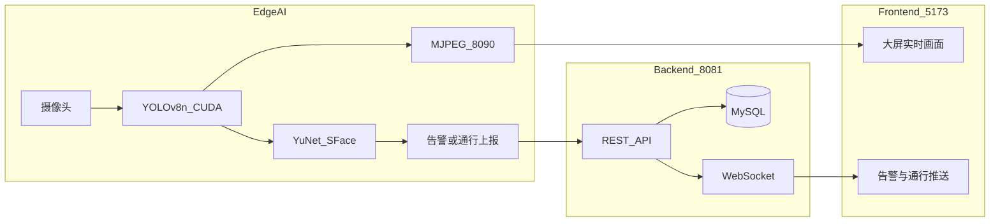

# Intelligent Door Alert System | 智能门禁安防可视化预警系统

<div align="center">

[](https://github.com/Ckj6818/intelligent-door-alert-system/releases)
[](./LICENSE)
[](https://spring.io/projects/spring-boot)
[](https://react.dev/)
[](https://github.com/ultralytics/ultralytics)
[](https://www.typescriptlang.org/)
[](https://www.docker.com/)

<p align="center">
  <b>边缘 YOLO 行人检测 + 人脸授权识别 + Spring Boot / React 实时告警大屏</b>
</p>

[数据库脚本](./docs/schema.sql) · [授权人脸迁移](./docs/migrate_auth_face.sql) · [AI 依赖说明](./door-alert-ai/requirements.txt)

</div>

---

## 项目简介

面向机房、实验室、库房等场景的端到端视觉安防演示系统：

1. **边缘 AI** 用摄像头采流，**YOLOv8n（可 CUDA）** 检测行人并计算接近度；
2. 人员足够近时，用 **YuNet 定位 + SFace 提特征** 与白名单比对（授权 / 识别中 / 未授权）；
3. 未授权经多帧确认后抓拍上报；授权写入通行日志；
4. **Spring Boot** 落库并用 **WebSocket** 推到管理端；
5. **React 大屏** 展示实时 YOLO 画面（MJPEG）、告警弹窗与处置闭环。

---

## 系统架构



| 服务 | 默认地址 |
|:---|:---|
| 管理端前端 | http://localhost:5173/login |
| 后端 API | http://localhost:8081 |
| YOLO 实时预览流 | http://localhost:8090/video |

---

## 核心能力

### 边缘视觉与身份识别
- **YOLOv8n + GPU**：行人检测；接近度 \(R = Area_{bbox}/Area_{frame}\)，低于阈值不做脸部推理。
- **YuNet + SFace**：人脸定位与特征比对（无 SFace 时可回退 dlib）；单次识别约几十到两百毫秒级。
- **三档判定 + 多帧确认**：中间相似度显示「识别中」不上报；明确陌生人需连续多次采样才告警，减轻侧脸误报。
- **MJPEG 推流**：与本机检测窗口同源的画框画面，供大屏嵌入。

### 实时告警与通行
- 未授权：冷却窗口防抖 + 异步抓拍上传。
- 授权：通行日志（非告警工单）+ 前端通行提示。
- WebSocket 推送告警 / 通行事件；高危弹窗与可选蜂鸣。

### 管理端与安全
- Sa-Token JWT + RBAC（`ADMIN` / `OPERATOR`）。
- 授权人员 CRUD（照片同步边缘白名单，支持热加载）。
- 告警处置、回收站、报表导出（xlsx）。

---

## 技术栈

| 领域 | 技术 |
|:---|:---|
| 边缘 AI | Python 3.12、Ultralytics YOLOv8n、OpenCV（YuNet/SFace）、可选 CUDA PyTorch |
| 后端 | Spring Boot 3.2、JDK 17、MyBatis-Plus、Sa-Token、MySQL 8、WebSocket |
| 前端 | React 19、TypeScript、Vite 6、Tailwind CSS 4 |
| 工程 | Docker Compose、GitHub Actions CI |

> 人脸 onnx 模型（YuNet / SFace）与 YOLO `.pt` 权重默认不入库，需本机下载到 `door-alert-ai/models/` 与项目目录。

---

## 快速启动

### Windows 一键启动

1. 安装 JDK 17+、Node.js 18+、Python 3.10+、MySQL 8；
2. 执行 [`docs/schema.sql`](./docs/schema.sql)（可选 [`docs/seed_data.sql`](./docs/seed_data.sql)；人脸相关可参考 [`docs/migrate_auth_face.sql`](./docs/migrate_auth_face.sql)）；
3. 准备 `door-alert-ai` 依赖与模型（见 [`requirements.txt`](./door-alert-ai/requirements.txt)）；
4. 双击 **`start_all.bat`**；
5. 打开 http://localhost:5173/login 。

### 手动启动

```bash
# 后端
cd door-alert-backend && mvn spring-boot:run

# 前端
cd door-alert-frontend && npm install && npm run dev

# 边缘 AI
cd door-alert-ai && pip install -r requirements.txt && python doorAlert.py
```

### Docker

```bash
docker compose up -d --build
docker compose --profile full up -d --build   # 含 AI 节点
```

---

## 演示账号

| 角色 | 用户名 | 密码 |
|:---|:---|:---|
| 管理员 | `admin` | `123456` |
| 安保 | `security` | `123456` |

---

## 目录结构

```text
intelligent-door-alert-system/
├── docs/                     # schema / seed / 迁移脚本
├── door-alert-ai/            # 边缘检测 + 人脸 + MJPEG
│   ├── doorAlert.py
│   ├── models/               # 本地 onnx（不入库）
│   └── authorized_faces/     # 白名单照片（个人照片不入库）
├── door-alert-backend/       # Spring Boot API + WebSocket
├── door-alert-frontend/      # React 管理大屏
├── scripts/                  # Windows 启动脚本
├── start_all.bat
└── docker-compose.yml
```

---

## 测试

```bash
cd door-alert-backend && mvn test
```

---

## 许可证

[MIT License](./LICENSE)

---

<div align="center">
  <sub>Kejie Chen（陈柯杰）· 毕业设计项目</sub>
</div>
