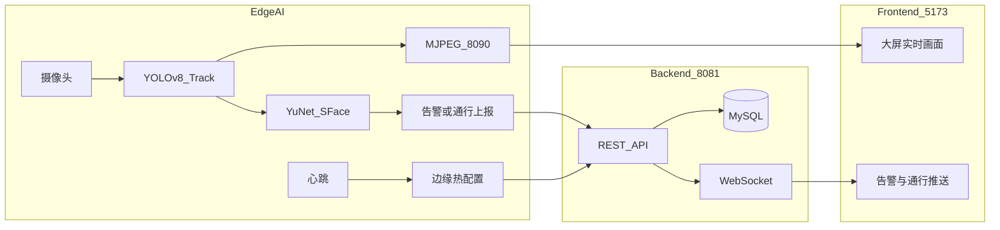

# Intelligent Door Alert System

<div align="center">


**智能门禁安防可视化预警系统**

边缘 YOLO 行人检测 · 人脸授权识别 · 距离/尾随/徘徊告警 · Spring Boot / React 实时大屏

[](https://github.com/Ckj6818/intelligent-door-alert-system/actions/workflows/ci.yml)
[](https://github.com/Ckj6818/intelligent-door-alert-system/releases)
[](./LICENSE)
[](https://spring.io/projects/spring-boot)
[](https://react.dev/)
[](https://github.com/ultralytics/ultralytics)
[](https://www.docker.com/)

[快速启动](#快速启动) · [核心能力](#核心能力) · [架构](#系统架构) · [演示账号](#演示账号) · [文档](#文档与脚本)

</div>

---

## 项目简介

面向机房、实验室、库房等场景的 **端到端视觉安防演示系统**（本科毕业设计）：

| 环节 | 做什么 |
|:---|:---|
| 边缘 AI | 摄像头采流 → YOLOv8 行人检测 → 接近度门控 → YuNet/SFace 白名单比对 |
| 云端后端 | 告警 / 通行落库、WebSocket 推送、边缘配置热下发、离线补传 |
| 管理大屏 | 实时 MJPEG 画面、告警处置闭环、通行对比、报表导出 |

---

## 核心能力

<details open>
<summary><b>边缘视觉</b></summary>

- **YOLOv8 + 可选 CUDA**：行人检测与跟踪（ByteTrack）
- **距离分层**：估计危险距离，支撑近场告警策略
- **YuNet + SFace**：人脸定位与特征比对；无 SFace 时可回退 dlib
- **三档判定 + 多帧确认**：识别中不上报；陌生人需连续采样，减轻侧脸误报
- **MJPEG 同源预览**：本机检测画框画面嵌入大屏（默认 `8090`）

</details>

<details open>
<summary><b>告警与通行</b></summary>

- 未授权告警：冷却防抖 + 异步抓拍上传
- **TAILGATING / LOITERING**：尾随、徘徊等扩展告警类型
- 授权通行：写入通行日志（非告警工单）+ 前端提示
- **离线 FIFO 缓存**：断网暂存，恢复后按序补传
- WebSocket 实时推送；高危弹窗与可选蜂鸣

</details>

<details open>
<summary><b>管理端与安全</b></summary>

- Sa-Token JWT + RBAC（`ADMIN` / `OPERATOR`）
- 授权人员 CRUD，照片同步边缘白名单并热加载
- **边缘参数热下发**：危险距离 / 冷却 / 人脸阈值 / 尾随开关（经心跳）
- 告警处置、回收站、通行对比统计、Excel 报表导出

</details>

---

## 系统架构



| 服务 | 默认地址 |
|:---|:---|
| 管理端 | http://localhost:5173/login |
| 后端 API | http://localhost:8081 |
| YOLO 预览流 | http://localhost:8090/video |

---

## 技术栈

| 领域 | 技术 |
|:---|:---|
| 边缘 AI | Python 3.12、Ultralytics YOLOv8、OpenCV YuNet/SFace、可选 CUDA |
| 后端 | Spring Boot 3.2、JDK 17、MyBatis-Plus、Sa-Token、MySQL 8、WebSocket |
| 前端 | React 19、TypeScript、Vite 6、Tailwind CSS 4 |
| 工程 | Docker Compose、GitHub Actions CI |

> 人脸 onnx（YuNet / SFace）与 YOLO 权重默认不入库，请放到 `door-alert-ai/models/` 与项目约定路径。

---

## 快速启动

### Windows 一键启动（推荐日常开发 / 真摄像头）

1. 安装 JDK 17+、Node.js 18+、Python 3.10+、MySQL 8  
2. 导入 [`docs/schema.sql`](./docs/schema.sql)（可选 [`docs/seed_data.sql`](./docs/seed_data.sql)）  
3. 安装 AI 依赖与模型（见 [`door-alert-ai/requirements.txt`](./door-alert-ai/requirements.txt)）  
4. 双击 **`start_all.bat`**  
5. 打开 http://localhost:5173/login  

### Docker 一键部署（换机演示 / 少装本机环境）

```bash
# 需先启动 Docker Desktop
docker compose up -d --build

# 含 AI 节点（Windows 默认用 demo 图，无法直连 USB 摄像头）
docker compose --profile full up -d --build
```

| 说明 | 详情 |
|:---|:---|
| 访问 | 前端 `5173` · API `8081` |
| 本机 MySQL | Compose 内 MySQL **不映射 3306**，一般不冲突 |
| 端口 | 勿与 `start_all.bat` 同时占用 8081 / 5173 |
| 国内拉镜像 | 若 Docker Hub 超时，可用镜像站拉取后 `docker tag` 为官方名再 `compose up` |

物理摄像头叠加文件（**仅 Linux / WSL2**）：[`docker-compose.camera.yml`](./docker-compose.camera.yml)

### 手动启动

```bash
cd door-alert-backend && mvn spring-boot:run
cd door-alert-frontend && npm install && npm run dev
cd door-alert-ai && pip install -r requirements.txt && python doorAlert.py
```

---

## 演示账号

| 角色 | 用户名 | 密码 |
|:---|:---|:---|
| 管理员 | `admin` | `123456` |
| 安保 | `security` | `123456` |

---

## 目录结构

```text
intelligent-door-alert-system/
├── docs/                     # schema / seed / 迁移 / 截图
├── door-alert-ai/            # 边缘检测 + 人脸 + MJPEG
├── door-alert-backend/       # Spring Boot API + WebSocket
├── door-alert-frontend/      # React 管理大屏
├── scripts/                  # Windows 辅助脚本
├── start_all.bat             # 本机一键启动
├── docker-compose.yml        # 容器编排
└── docker-compose.camera.yml # Linux 摄像头叠加
```

---

## 文档与脚本

| 文档 | 说明 |
|:---|:---|
| [`docs/schema.sql`](./docs/schema.sql) | 建库 + 基础账号 |
| [`docs/seed_data.sql`](./docs/seed_data.sql) | 答辩演示种子数据 |
| [`docs/migrate_auth_face.sql`](./docs/migrate_auth_face.sql) | 授权人脸相关迁移 |
| [`docs/migrate_alert_edge.sql`](./docs/migrate_alert_edge.sql) | 边缘告警 / 配置相关迁移 |
| [`docs/screenshots/`](./docs/screenshots/) | 仓库展示图 |

---

## 测试

```bash
cd door-alert-backend && mvn test
```

CI：推送到 `master` / `main` / `dev` 时自动跑后端测试与前端构建（见 [`.github/workflows/ci.yml`](./.github/workflows/ci.yml)）。

---

## 许可证

[MIT License](./LICENSE)

---

<div align="center">

**Kejie Chen（陈柯杰）** · 毕业设计项目

[Issues](https://github.com/Ckj6818/intelligent-door-alert-system/issues) · [Pull Requests](https://github.com/Ckj6818/intelligent-door-alert-system/pulls)

</div>
