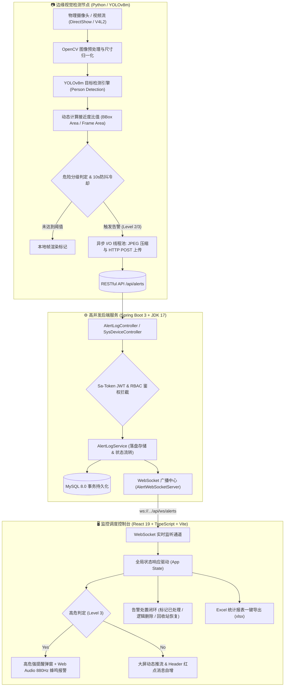

# 🛡️ Intelligent Door Alert System | 智能门禁安防可视化预警系统

<div align="center">

[](https://github.com/Ckj6818/intelligent-door-alert-system/releases)
[](./LICENSE)
[](https://spring.io/projects/spring-boot)
[](https://react.dev/)
[](https://github.com/ultralytics/ultralytics)
[](https://www.typescriptlang.org/)
[](https://www.docker.com/)
[](https://github.com/Ckj6818/intelligent-door-alert-system/actions)

<p align="center">
  <b>基于 YOLOv8m 深度学习目标检测与 Spring Boot 3 + React 19 的高可靠边缘视觉安防与实时告警分发管理平台</b>
</p>

[简体中文](./README.md) | [数据库脚本](./docs/schema.sql) | [授权人脸迁移](./docs/migrate_auth_face.sql)

</div>

---

## 📌 项目简介 (Overview)

**Intelligent Door Alert System** 是一套面向高安全要求场所（如机房、实验室、重点库房、智能家居门禁）的工业级端到端智能视觉安防系统。

系统通过边缘端摄像头实时推流，利用 **YOLOv8m** 深度神经网络进行目标检测与入侵接近度（Proximity Ratio）动态测算。一旦判定越界或异常入侵，边缘节点即刻异步抓拍并通过 **HTTP POST** 上报，后端 **Spring Boot 3** 结合 **WebSocket** 毫秒级向前端大屏推流，触发高危声光弹窗与安保调度处置闭环。

---

## 🏗️ 系统全栈拓扑架构 (Architecture)



---

## 🌟 核心特性与技术亮点 (Key Highlights)

### 1. 🎯 边缘视觉与自适应接近度算法
- **深度模型优化**：采用 Ultralytics **YOLOv8m** 卷积神经网络架构（参数量 25.9M），在推流帧率（30+ FPS）与检测精度（mAP）间取得最优平衡。
- **动态接近度算法**：创新设计目标面积占比函数 $R_{proximity} = \frac{Area_{bbox}}{Area_{frame}}$，根据几何投影自动量化目标入侵威胁等级（1: 低危 / 2: 中危 / 3: 高危）。
- **流控与防抖冷却**：具备 10 秒时间窗口防抖机制（Cooldown Window），避免短时间内由于光影抖动或目标徘徊造成的瞬时告警风暴。
- **高并发非阻塞 I/O**：Python 边缘侧采用多线程异步上报（`threading.Thread`），现场抓拍与网络上传完全脱离主推流渲染管线，确保视频流零卡顿。

### 2. ⚡ 毫秒级全双工推送与声光联动
- **WebSocket 实时推流**：基于 `spring-boot-starter-websocket` 搭建专属长连接通道，告警上报至大屏渲染延时低于 **50ms**。
- **Web Audio 警报合成**：纯前端调用 `AudioContext` 动态合成 880Hz 锯齿波高频告警音，支持在系统参数设置中实时持久化静音配置。

### 3. 🔒 生产级安全防护与 RBAC 权限隔离
- **无状态 JWT 鉴权**：整合 **Sa-Token 1.39** 认证框架，实现 Token 自动续签与过期平滑重定向拦截。
- **密码单向加盐哈希**：基于 `BCryptPasswordEncoder` 实现账户密码安全散列，杜绝数据库明文泄露风险。
- **多角色权限管控**：
  - `ADMIN`（超级管理员）：具备全局报表导出、安保账号 CRUD 与密码一键重置、设备与系统参数管理全量权限。
  - `OPERATOR`（安保值班员）：仅具备监控大屏查看与日常告警复核处理权限。

### 4. 📊 闭环处置与可视化报表
- **告警全生命周期管理**：支持「待复核 → 已确认 → 已处置」状态流转，提供回收站（Recycle Bin）软删除、单条/批量恢复及物理彻底清除。
- **数据报表导出**：集成 `xlsx` 引擎，支持将告警时间、设备信息、危险分级及现场抓拍图直链一键导出为标准 Excel 报表。

### 5. 🐳 容器化与 CI/CD 工业级工程实践
- **Docker Compose 编排**：一键拉起 MySQL、Spring Boot 后端、Vite 前端与 Python AI 服务，支持 Linux 物理摄像头设备直通（`/dev/video0`）。
- **自动化持续集成**：配置 GitHub Actions 工作流，代码提交自动并行触发 Maven 编译打包、JUnit 单元测试与 TypeScript 编译校验。

---

## 🛠️ 技术栈一览 (Tech Stack)

| 领域 | 关键技术 | 版本 | 说明 |
|:---|:---|:---|:---|
| **AI & 边缘端** | Python / PyTorch | 3.9+ | 核心推理脚本与并发调度 |
| | Ultralytics YOLOv8m | 8.x | 目标检测与分类模型 |
| | OpenCV (cv2) | 4.x | 视频流采集与图像几何变换 |
| **后端架构** | Spring Boot | 3.2.4 | 微服务基础设施 |
| | Java SDK | 17 (LTS) | 现代 Java 运行时 |
| | MyBatis-Plus | 3.5.5 | 增强型 ORM 持久层框架 |
| | Sa-Token | 1.39.0 | 分布式权限认证框架 |
| | MySQL | 8.0.x | 关系型数据库 |
| | WebSocket | JSR 356 | 全双工实时通信 |
| **前端大屏** | React | 19.0.1 | 声明式 UI 渲染框架 |
| | TypeScript | 5.8.2 | 强类型静态检查 |
| | Vite | 6.2.3 | 新一代前端构建工具 |
| | TailwindCSS | 4.1.14 | 原子化现代化样式系统 |
| | Motion | 12.23.x | 赛博风格动画与转场动效 |
| | Lucide React | 0.546.x | 现代化高精度矢量图标库 |
| **DevOps** | Docker & Compose | v2+ | 多容器统一编排 |
| | GitHub Actions | CI/CD | 自动化测试与持续集成 |

---

## 🚀 快速启动指南 (Quick Start)

### 方式一：一键启动（推荐 · Windows 演示环境）

项目根目录提供了全自动启动脚本，双击即可一键拉起 4 个独立服务窗口：

1. **环境准备**：确保本机已配置 JDK 17+、Node.js 18+、Python 3.9+ 及 MySQL 8；
2. **初始化数据**：在 MySQL 中执行 [`docs/schema.sql`](./docs/schema.sql)（可选导入 [`docs/seed_data.sql`](./docs/seed_data.sql)）；
3. **一键运行**：双击根目录下的 **`start_all.bat`**；
4. **访问系统**：浏览器打开 **http://localhost:5173/login**。

---

### 方式二：手动分步启动

<details>
<summary><b>点击展开各模块手动启动指令</b></summary>

#### 1. 启动后端 (Port: 8081)
```bash
cd door-alert-backend
mvn clean spring-boot:run
```

#### 2. 启动前端 (Port: 5173)
```bash
cd door-alert-frontend
npm install
npm run dev
```

#### 3. 启动 AI 检测节点
```bash
cd door-alert-ai
pip install -r requirements.txt
python doorAlert.py
```

</details>

---

### 方式三：Docker Compose 容器化部署

```bash
# 启动基础核心栈（MySQL + Spring Boot 后端 + React 前端）
docker compose up -d --build

# 完整启动（包含边缘 AI 模拟检测节点）
docker compose --profile full up -d --build
```

---

## 🔑 系统默认演示账号 (Credentials)

| 角色 (Role) | 用户名 (Username) | 默认密码 (Password) | 权限说明 (Permissions) |
|:---|:---|:---|:---|
| **超级管理员** | `admin` | `123456` | 完整权限：大屏监控、告警处置、报表导出、安保人员增删改查、参数设置 |
| **安保值班员** | `security` | `123456` | 运维权限：大屏监控、告警确认与处置复核（无账号管理与数据导出权限） |

---

## 📂 项目工程目录 (Repository Structure)

```text
intelligent-door-alert-system/
├── .github/workflows/ci.yml       # GitHub Actions 自动化 CI 配置文件
├── docker/                        # Docker 镜像构建相关脚本
├── docker-compose.yml             # 生产级多服务容器编排配置
├── docker-compose.camera.yml      # Linux 物理摄像头直通编排配置
├── docs/                          # 数据库脚本与迁移
│   ├── schema.sql                 # MySQL 表结构 DDL 定义
│   ├── seed_data.sql              # 演示测试种子数据
│   └── migrate_auth_face.sql      # 授权人脸相关表迁移
├── door-alert-ai/                 # Python 边缘 AI（YOLOv8n + YuNet/SFace）
│   ├── doorAlert.py               # 检测 / 人脸授权 / 上报 / 心跳
│   ├── models/                    # YuNet / SFace onnx（本地放置，不入库）
│   ├── authorized_faces/          # 授权人脸白名单照片
│   ├── requirements.txt           # Python 依赖清单
│   └── demo/                      # 离线演示素材
├── door-alert-backend/            # Spring Boot 3 后端核心工程
│   ├── src/main/java/             # 业务逻辑代码（Controller/Service/Entity）
│   ├── src/main/resources/        # 配置文件（application.yml）
│   └── src/test/                  # JUnit 5 + H2 自动化单元测试集
├── door-alert-frontend/           # React 19 + TypeScript 前端大屏工程
│   ├── src/components/            # 核心组件库（大屏/工作流/报表/设置）
│   ├── src/App.tsx                # 全局状态管理与 WebSocket 监听
│   └── package.json               # 前端依赖配置
├── scripts/                       # Windows 运维及一键启动脚本集合
├── start_all.bat                  # 根目录全量一键启动入口
└── LICENSE                        # MIT 开源许可证
```

---

## 🧪 自动化测试与质量保证 (Testing & Quality)

后端配置了基于 **JUnit 5 + H2 内存数据库** 的完整自动化测试套件：

```bash
cd door-alert-backend
mvn test
```

- `DoorAlertApplicationTests`：Spring Boot 容器加载与上下文健康探针测试
- `SysDeviceHeartbeatTest`：边缘设备心跳更新与掉线状态判定测试
- `AlertLogServiceTest`：告警分页检索、危险分级过滤与状态流转测试
- `SysUserServiceTest`：用户鉴权、BCrypt 密码哈希重置与 RBAC 权限隔离测试

---

## 📄 许可证 (License)

本项目基于 [MIT License](./LICENSE) 协议开源。

---

<div align="center">
  <sub>Developed with ❤️ by Kejie Chen (陈柯杰) · 毕业设计优秀示范工程</sub>
</div>
