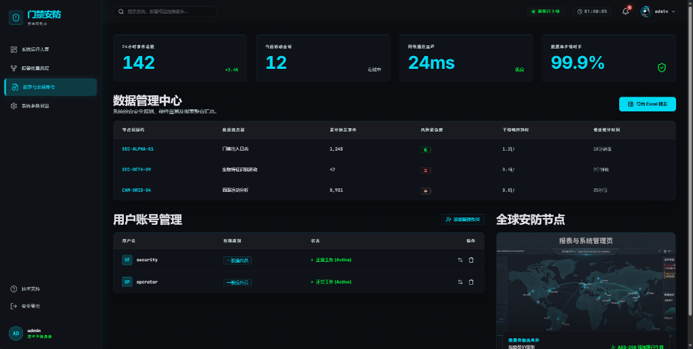
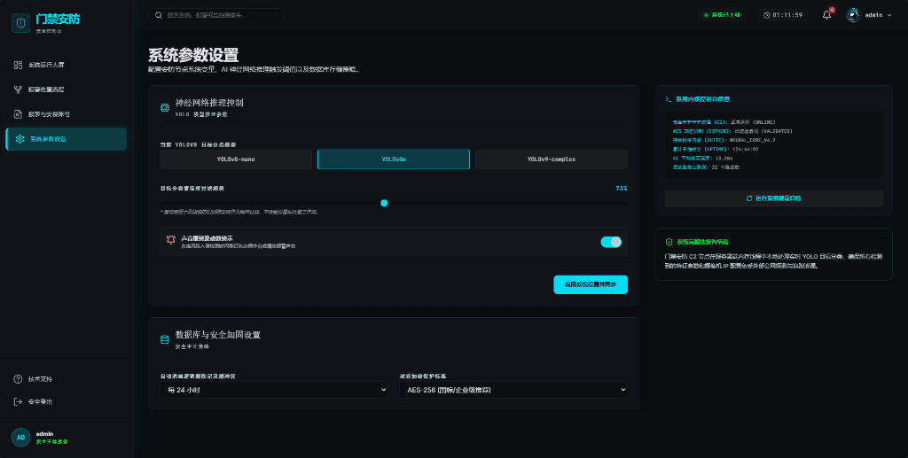
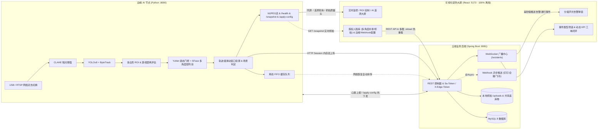
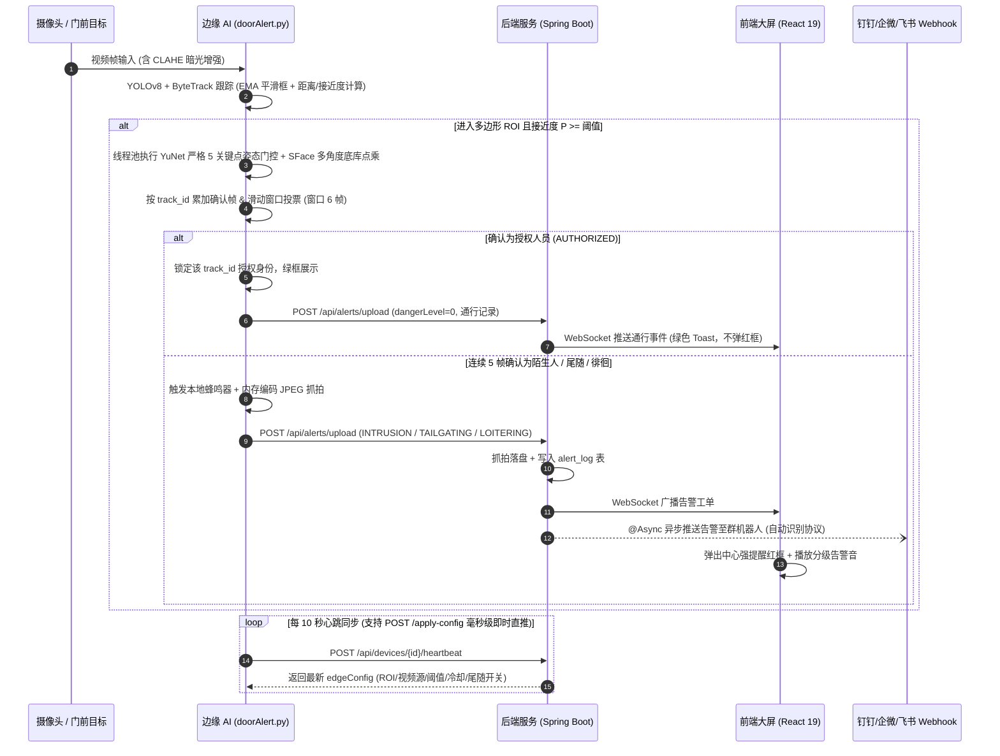

<div align="center">


# Intelligent Door Alert System

**基于 YOLOv8 + ByteTrack 与 YuNet/SFace 的智能门禁安防可视化预警系统**

边缘实时行人跟踪 · 多角度人脸核验 · 透视距离与行为识别 · 钉钉/企微/飞书推送 · 云边协同大屏

[](https://github.com/Ckj6818/intelligent-door-alert-system/actions/workflows/ci.yml)
[](https://github.com/Ckj6818/intelligent-door-alert-system/releases)
[](./LICENSE)
[](https://www.python.org/)
[](https://github.com/ultralytics/ultralytics)
[](https://opencv.org/)
[](https://spring.io/projects/spring-boot)
[](https://react.dev/)
[](https://www.docker.com/)
[](#-系统架构与数据流)
[](#-核心亮点)

[核心亮点](#-核心亮点) · [界面预览](#-界面预览) · [系统架构](#-系统架构与数据流) · [核心算法](#-核心视觉算法) · [快速启动](#-快速启动) · [接口与配置](#-接口与配置速查)

</div>

---

## 📖 项目简介

**Intelligent Door Alert System** 是一套面向机房、实验室、重点库房等场景的 **云边协同智能门禁安防系统**（本科毕业设计作品）。系统由 **Python 边缘 AI 视觉节点**、**Spring Boot 3 业务与实时推送后端** 以及 **React 19 赛博安防可视化大屏** 三部分组成，完整覆盖从「实时视频流感知 → 多角度身份核验与异常行为判定 → 毫秒级大屏/群机器人告警推送 → 工单闭环处置与报表导出」的全业务链路。

| 模块 | 核心职责 | 关键技术 |
|:---|:---|:---|
| **边缘 AI 节点** (`door-alert-ai`) | 视频流/RTSP 热切换、暗光增强、行人检测与跟踪、多边形 ROI 防区、多角度人脸底库融合与侧脸防误报姿态门控、`/snapshot` 抓拍质量检测、离线缓存与 `/health` 遥测 | `YOLOv8` + `ByteTrack`、`YuNet` + `SFace`、`CLAHE`、`RTSP/FFmpeg` |
| **云端业务后端** (`door-alert-backend`) | 告警与通行落库、WebSocket 广播、钉钉/企微/飞书 Webhook 异步推送、心跳与 `X-Edge-Token` 鉴权、边缘配置热下发、回收站定时清理、行内照片补录与多图同步清理 | `Spring Boot 3.2`、`MyBatis-Plus`、`Sa-Token`、`@Async/@Scheduled`、`MySQL 8` |
| **安防可视化大屏** (`door-alert-frontend`) | 同源 MJPEG 检测流、鼠标绘制多边形 ROI 防区、RTSP 热切换、行内摄像头实时抓拍建库、AI 遥测曲线、分级声光弹窗、事件类型筛选与 100% 离线零外部图床依赖 | `React 19`、`TypeScript`、`Vite 6`、`Tailwind CSS 4`、`Web Audio API` |

---

## ✨ 核心亮点

<table>
<tr>
<td width="50%" valign="top">

### 🎯 1. 融合透视距离与轨迹平滑的目标感知
- **ByteTrack 持久跟踪**：维护门前目标唯一 `track_id`、运动趋势（`靠近 / 远离 / 路过`）与防区滞留时长。
- **综合接近度与距离估计**：融合框面积占比、底部接地点垂直位置与透视距离因子，支持多边形/矩形 ROI 警戒区判定与 `SAFE / WARN / DANGER` 三档距离分层。
- **检测框 EMA 滤波**：按 `track_id` 对边界框坐标做指数滑动平均平滑，消除近距离抖动并稳定距离估计。

</td>
<td width="50%" valign="top">

### ⚡ 2. YuNet + SFace 完整度门控与多角度防伪核验
- **五官与视野边界完整度门控**：强制校验 YuNet 置信度（`≥ 0.78`）、五官纵向解剖比例（眼→鼻→嘴间距）及画面四边截断状态，防止只露半张脸或低头遮挡嘴部（如喝水/进食）时误报陌生人；同时自适应近景半身 ROI 裁剪，避免近距桌面摄像头裁掉下巴。
- **双重物理防伪拦截引擎（`SPOOFING`）**：融合 **YOLOv8n COCO 电子屏/手机/相册实体检测**（`cell phone / tv / laptop / book` 二次核验屏幕内人脸与高亮屏）+ **三边 `Π` 型黑边亮屏跃变与四边正交梯度边框检测**，一旦检出手机翻拍或照片冒用即刻清除历史授权缓存并阻断放行。
- **同人多角度底库融合与行内抓拍**：自动聚合 `姓名.jpg`、`姓名_后缀.jpg` 等同人多张底库并辅以水平翻转双模板增广，前端可直接调用 `GET /snapshot` 一键现场抓拍建库并实时反馈人脸质量状态。

</td>
</tr>
<tr>
<td width="50%" valign="top">

### 🛡️ 3. 四类核心异常识别与多渠道触达
- **四类核心安防事件**：
  - `INTRUSION`：非授权人员/陌生人进入近场防区告警
  - `SPOOFING`：手机亮屏 / 纸质照片翻拍冒用防伪拦截告警（琥珀色高亮标识）
  - `TAILGATING`：授权人员通行后短时间窗口内陌生人尾随闯入告警
  - `LOITERING`：门前防区长时间遮挡徘徊超时告警
- **钉钉 / 企业微信 / 飞书 Webhook 增强推送**：支持按平台自动适配协议、页面动态配置**抓拍图外网/局域网访问基地址**与卡片内嵌缩略图预览，并在边缘节点心跳超时掉线时主动发送**设备离线告警**。
- **暗光增强、离线缓存与 Docker 共享底库**：夜间启用 CLAHE 自适应增强；断联时自动写入 FIFO 离线队列补传；容器编排通过 `authorized_faces` 共享卷与 `X-Edge-Token` 实现跨容器白名单秒级热同步。

</td>
<td width="50%" valign="top">

### 🖥️ 4. 全真数据离线大屏、审计闭环与可视化报表
- **零原生弹窗赛博交互体系**：全站内置全局 `CyberToastHost` 与 `CyberConfirmHost` 赛博弹窗体系，彻底摒弃浏览器原生 `alert/confirm`，实时预览支持鼠标绘制多边形 ROI 防区、免重启热切换 RTSP/USB 视频源及事件流抓拍大图直览。
- **工单处置全流程审计闭环**：告警处置自动持久化记录**处置人（`handler`）、处置时间（`handle_time`）与快捷/自定义复核结论（`handle_remark`）**，支持「重新核实」回退待处理状态，并完整导出至 `.xlsx` 审计报表。
- **真数据多维图表与系统安全治理**：数据管理中心集成**四类告警分布环图**与**近 7 日通行/拦截趋势对比柱图**；设置页内置回收站自动保留周期策略（24h / 7天 / 永久）、活体防伪开关与 BCrypt 个人密码修改功能。

</td>
</tr>
</table>

---

## 🖼️ 界面预览

| 数据管理与安全审计中心 | 神经网络推理控制与系统参数配置 |
|:---:|:---:|
|  |  |

---

## 🏗️ 系统架构与数据流

### 拓扑架构



### 核心告警与通行时序



---

## 🧠 核心视觉算法

<details open>
<summary><b>1. 透视接地点距离估计与综合接近度模型</b></summary>

单一的检测框面积占比在目标半身出画或不同俯仰角下容易失真。本系统引入 **检测框底部接地点垂直位置** 与 **透视距离因子** 构建综合接近度 $P \in [0, 1]$：

$$
R_{\text{area}} = \frac{(x_2 - x_1)(y_2 - y_1)}{W \cdot H}, \quad R_{\text{foot}} = \frac{y_2}{H}, \quad d_{\text{factor}} = \frac{H - y_2}{(y_2 - y_1) + \varepsilon}
$$

$$
S_{\text{persp}} = \frac{1}{1 + 1.8 \cdot d_{\text{factor}}}, \quad P = \text{clip}\Big(0.45\,\min(1, 2.2 R_{\text{area}}) + 0.30\,R_{\text{foot}} + 0.25\,S_{\text{persp}},\; 0,\; 1\Big)
$$

同时结合像素身高与地面透视估计物理距离 $D_{\text{est}}$（单位：米），划分为 `DANGER`（$\le 1.5\text{m}$）、`WARN`（$\le 2.8\text{m}$）、`SAFE`（$> 2.8\text{m}$）三档。

</details>

<details open>
<summary><b>2. YuNet 五关键点严格侧脸姿态门控与 SFace 多角度融合矩阵匹配</b></summary>

1. **正侧脸严格几何门控**：提取左眼 $(x_{le}, y_{le})$、右眼 $(x_{re}, y_{re})$、鼻尖 $(x_n, y_n)$ 与左右嘴角关键点，结合双目横纵偏斜与嘴部对称性，当双目水平间距占人脸宽度比例 `< 0.32`（`FACE_MIN_EYE_SPAN_RATIO`）、鼻尖未落于双目水平区间内，或综合偏转对称度 $\frac{|x_n - (x_{le}+x_{re})/2|}{|x_{re}-x_{le}|} > 0.20$（`FACE_MAX_YAW_ASYM`）时判定为侧脸，记为 `quality_reject`（保持“识别中”，不计入陌生人连续确认帧）。
2. **多角度底库融合与双模板矩阵点乘**：加载时自动将 `姓名.jpg`、`姓名_左.jpg`、`姓名_右.jpg` 等同人多角度照片归并至同一身份，并为每张照片提取原图与水平翻转两条 $L_2$ 归一化 128 维特征，拼接为矩阵 $\mathbf{M} \in \mathbb{R}^{2N \times 128}$。实时比对仅需一次矩阵乘法 $\mathbf{s} = \mathbf{M}\mathbf{v}$，按身份取最大余弦相似度 $s_{\max} = \max(\mathbf{s})$：
   - $s_{\max} \ge \tau_{\text{strong}}$（默认 `0.45`）：强授权直接通过；
   - $s_{\max} \ge \tau_{\text{auth}}$（默认 `0.363`）：计入授权确认帧（默认连续 2 帧确认锁定）；
   - $s_{\max} \le \tau_{\text{reject}}$（默认 `0.22`）：计入未授权确认帧（轨迹滑动投票窗口 `6` 帧，连续 5 帧确认触发告警）；
   - $\tau_{\text{reject}} < s_{\max} < \tau_{\text{auth}}$：模糊灰区，继续采样不误报。

</details>

---

## 🚀 快速启动

### 方式一：Windows 一键启动（推荐日常开发 / 物理摄像头实测）

1. **环境准备**：安装 `JDK 17+`、`Node.js 18+`、`Python 3.10+`、`MySQL 8.0`
2. **初始化数据库**：
   ```sql
   -- 依次执行建表脚本与可选演示种子数据
   source docs/schema.sql;
   source docs/seed_data.sql;
   ```
3. **安装 Python 依赖**：
   ```bash
   cd door-alert-ai
   pip install -r requirements.txt
   ```
   > 确保 `door-alert-ai/models/` 下已放置 `face_detection_yunet_2023mar.onnx` 与 `face_recognition_sface_2021dec.onnx`。
4. **一键启动三端服务**：双击仓库根目录下的 **`start_all.bat`**
5. **访问系统**：打开浏览器访问 http://localhost:5173/login

### 方式二：Docker Compose 容器化部署

```bash
# 仅启动 MySQL + 后端 + 前端大屏
docker compose up -d --build

# 完整启动（含 AI 边缘节点，默认使用演示图片推理）
docker compose --profile full up -d --build

# Linux / WSL2 下挂载物理 USB 摄像头 (/dev/video0)
docker compose -f docker-compose.yml -f docker-compose.camera.yml --profile full up -d --build
```

### 方式三：分模块手动启动

```bash
# 1. 启动 Spring Boot 后端 (端口 8081)
cd door-alert-backend && mvn spring-boot:run

# 2. 启动 React 前端大屏 (端口 5173)
cd door-alert-frontend && npm install && npm run dev

# 3. 启动 Python 边缘 AI 节点 (MJPEG 流端口 8090)
cd door-alert-ai && python -u doorAlert.py
```

---

## 🔑 演示账号与服务端口

| 角色 | 用户名 | 密码 | 权限范围 |
|:---|:---|:---|:---|
| **系统管理员 (`ADMIN`)** | `admin` | `123456` | 全量监控大屏、告警处置、授权人脸增删、系统参数热下发、用户管理、回收站永久清理、报表导出 |
| **安保操作员 (`OPERATOR`)** | `security` | `123456` | 实时监控大屏、告警确认与派单处置、通行记录查看 |

| 服务模块 | 默认地址 | 说明 |
|:---|:---|:---|
| **前端管理大屏** | http://localhost:5173/login | 赛博安防可视化控制台（100% 离线资源） |
| **后端 REST & WS** | http://localhost:8081 | REST API 与 `/ws/alerts` 实时推送 |
| **边缘 MJPEG 视频流** | http://localhost:8090/video | 带实时检测框与中文 HUD 的 MJPEG 流 |
| **边缘纯净抓拍接口** | http://localhost:8090/snapshot | 返回无框原图并附带 `X-Face-Detected` / `X-Face-Quality` 质量检测头 |
| **边缘健康与遥测接口** | http://localhost:8090/health | 返回实时 `fps`、`yolo_ms`、`face_ms` 等遥测 JSON（另支持 `POST /apply-config` 热更新） |

---

## ⚙️ 接口与配置速查

<details>
<summary><b>边缘 AI 与后端常用环境变量（点击展开）</b></summary>

| 环境变量 | 默认值 | 说明 |
|:---|:---|:---|
| `VIDEO_SOURCE` | `0` | 视频输入源：摄像头索引（`0`/`1`）、RTSP 网络流（`rtsp://...`）、视频或静态图片，支持大屏热切换 |
| `EDGE_API_TOKEN` | 空（开发免校验） | 可选边缘通信共享密钥；配置后后端将校验 `/upload` 与 `/heartbeat` 的 `X-Edge-Token` 请求头 |
| `AUTHORIZED_FACES_DIR` | `../door-alert-ai/authorized_faces` | 后端与边缘共享白名单底库目录（AI 节点默认 `authorized_faces`，Docker 挂载至 `/app/authorized_faces`） |
| `YOLO_WEIGHTS` | `yolov8n.pt` | YOLO 权重路径（若当前目录无 `yolov8n.pt` 则回退 `yolov8m.pt`） |
| `YOLO_DEVICE` | `auto` | 推理设备：`auto`（自动检测 CUDA）、`cpu`、`cuda:0` |
| `YOLO_HALF` | `0` | GPU 下是否开启 FP16 半精度推理（`1` 开启 / `0` 关闭） |
| `FACE_ENGINE` | `auto` | 人脸识别引擎：`auto`（优先 `sface`，无模型回退 `dlib`） |
| `FACE_MAX_WORKERS` | `2` | 多目标并发人脸识别工作线程数 |
| `FACE_MAX_YAW_ASYM` | `0.20` | YuNet 5 关键点正侧脸对称度阈值（超过则判 `quality_reject` 不误报） |
| `FACE_MIN_EYE_SPAN_RATIO` | `0.32` | 双目水平间距占人脸宽度最小比例（过滤大角度侧脸） |
| `SFACE_COSINE_THRESHOLD` | `0.363` | SFace 授权判定余弦相似度阈值 |
| `SFACE_REJECT_THRESHOLD` | `0.22` | SFace 明确陌生人判定余弦相似度上限 |
| `UNAUTH_CONFIRM_FRAMES` | `5` | 连续确认多少帧陌生人后触发告警（滑动投票窗口 `6` 帧） |
| `PROXIMITY_ALERT_THRESHOLD` | `0.35` | 触发人脸识别与近场告警的综合接近度阈值 |
| `DANGER_DISTANCE_M` | `1.5` | 危险距离阈值（米），可通过管理端热下发 |
| `LOITER_DWELL_SECONDS` | `10.0` | 触发门前徘徊告警（`LOITERING`）的滞留秒数 |
| `TAILGATE_WINDOW_SECONDS` | `4.0` | 授权通行后检测尾随闯入（`TAILGATING`）的时间窗口（秒） |
| `ALERT_WEBHOOK_ENABLED` | `false` | 是否启用外部 Webhook 告警推送（亦可在系统设置页持久化保存至 `webhook-config.json`） |
| `ALERT_WEBHOOK_URL` | 空 | 钉钉 / 企业微信 / 飞书机器人 Webhook 地址（自动识别协议） |

</details>

<details>
<summary><b>后端核心 REST / WebSocket 接口一览（点击展开）</b></summary>

| 方法 | 路径 | 说明 |
|:---|:---|:---|
| `POST` | `/api/users/login` | 账号登录，签发 Sa-Token 令牌 |
| `POST` | `/api/alerts/upload` | 边缘节点上报抓拍图与告警/通行元数据（支持 `INTRUSION` / `TAILGATING` / `LOITERING`） |
| `GET` | `/api/alerts` | 分页查询告警工单列表（前端支持按 `alertType` 事件类型、中文处理状态及关键词筛选） |
| `GET` | `/api/passages/stats/today` | 今日授权放行与未授权拦截对比及近 7 日趋势统计 |
| `DELETE` | `/api/alerts/recycle-bin/clear` | 永久清空告警回收站并同步删除磁盘抓拍图片（另配 `@Scheduled` 自动定时清理超期记录） |
| `GET` | `/api/alerts/export` | 导出告警记录 JSON（仅 `ADMIN` 角色，前端生成 `.xlsx` 报表） |
| `POST` | `/api/devices/{id}/heartbeat` | 边缘设备心跳上报，返回在线确认与最新 `edgeConfig`（含多边形 ROI / RTSP 视频源 / 阈值） |
| `PUT` | `/api/devices/{id}/edge-config` | 保存边缘算法阈值、多边形 ROI 防区与视频源配置（仅 `ADMIN` 角色，支持直推边缘 `/apply-config`） |
| `GET/POST` | `/api/authorized-users` | 授权人员白名单管理（含 `faceTemplateCount` 统计，变更后写入 `.reload` 触发边缘端热重载） |
| `POST` | `/api/authorized-users/{id}/avatar` | 行内补录/更新人脸底库照片（支持 `mode=replace\|append` 替换或追加多角度模板） |
| `GET/PUT` | `/api/webhook/config` | 查询与保存钉钉/企微/飞书 Webhook 推送配置（仅 `ADMIN` 角色，持久化至本地 `webhook-config.json`） |
| `POST` | `/api/webhook/test` | 发送 Webhook 连通性测试消息并实时返回机器人接口响应（仅 `ADMIN` 角色） |
| `WS` | `/ws/alerts` | WebSocket 实时推送告警与通行事件 |

</details>

---

## 📂 目录结构

```text
intelligent-door-alert-system/
├── .github/                  # GitHub Actions CI 工作流、Issue/PR 模板、安全策略
├── docs/                     # 数据库建表/种子/迁移 SQL 脚本与 README 展示截图
│   ├── screenshots/          # 横幅与系统界面截图
│   ├── schema.sql            # 数据库初始化表结构与默认账号
│   └── seed_data.sql         # 答辩演示种子数据
├── door-alert-ai/            # Python 边缘 AI 视觉节点
│   ├── authorized_faces/     # 授权人员底库目录（支持 姓名_后缀.jpg 多角度融合与 .reload 热加载）
│   ├── models/               # YuNet / SFace ONNX 模型目录
│   ├── doorAlert.py          # 主程序：YOLO 跟踪、侧脸门控、SFace 多角度识别、MJPEG/抓拍与遥测
│   └── capture_authorized_face.py # 命令行人脸采集辅助工具
├── door-alert-backend/       # Spring Boot 3 后端工程
│   └── src/main/java/com/dooralert/
│       ├── controller/       # REST 接口层 (AlertLog / PassageLog / AuthorizedUser / Device / User / Webhook)
│       ├── service/          # 业务逻辑层 (含磁盘抓拍清理、多图底库同步、Webhook 异步推送与报表导出)
│       └── websocket/        # WebSocket 实时广播服务
├── door-alert-frontend/      # React 19 + TypeScript + Tailwind 4 前端工程
│   └── src/components/       # 大屏监控、告警弹窗、工单流转、多角度人脸抓拍管理、Webhook 设置
├── scripts/                  # Windows 批处理辅助启动脚本
├── docker-compose.yml        # 容器化一键编排配置（共享 authorized_faces 卷与 8090 端口映射）
├── docker-compose.camera.yml # Linux 物理摄像头设备挂载叠加配置
├── start_all.bat             # Windows 本地开发环境一键启动脚本
└── stop_all.bat              # Windows 本地开发环境一键优雅停服脚本
```

---

## 🧪 自动化测试与 CI

```bash
# 运行后端单元测试
cd door-alert-backend && mvn test

# 验证前端类型检查与生产构建
cd door-alert-frontend && npm run build
```

每次推送至 `master` / `main` / `dev` 分支时，GitHub Actions（[`.github/workflows/ci.yml`](./.github/workflows/ci.yml)）会自动执行后端 Maven 构建测试与前端 Vite 生产打包检查。

---

## 📄 开源许可证

本项目基于 [MIT License](./LICENSE) 开源。

---

<div align="center">

**Designed & Developed by Kejie Chen（陈柯杰）** · 本科毕业设计项目

如果这个项目对你有帮助，欢迎点亮右上角的 ⭐ **Star** 支持！

[报告问题 (Issues)](https://github.com/Ckj6818/intelligent-door-alert-system/issues) · [提交贡献 (Pull Requests)](https://github.com/Ckj6818/intelligent-door-alert-system/pulls)

</div>
